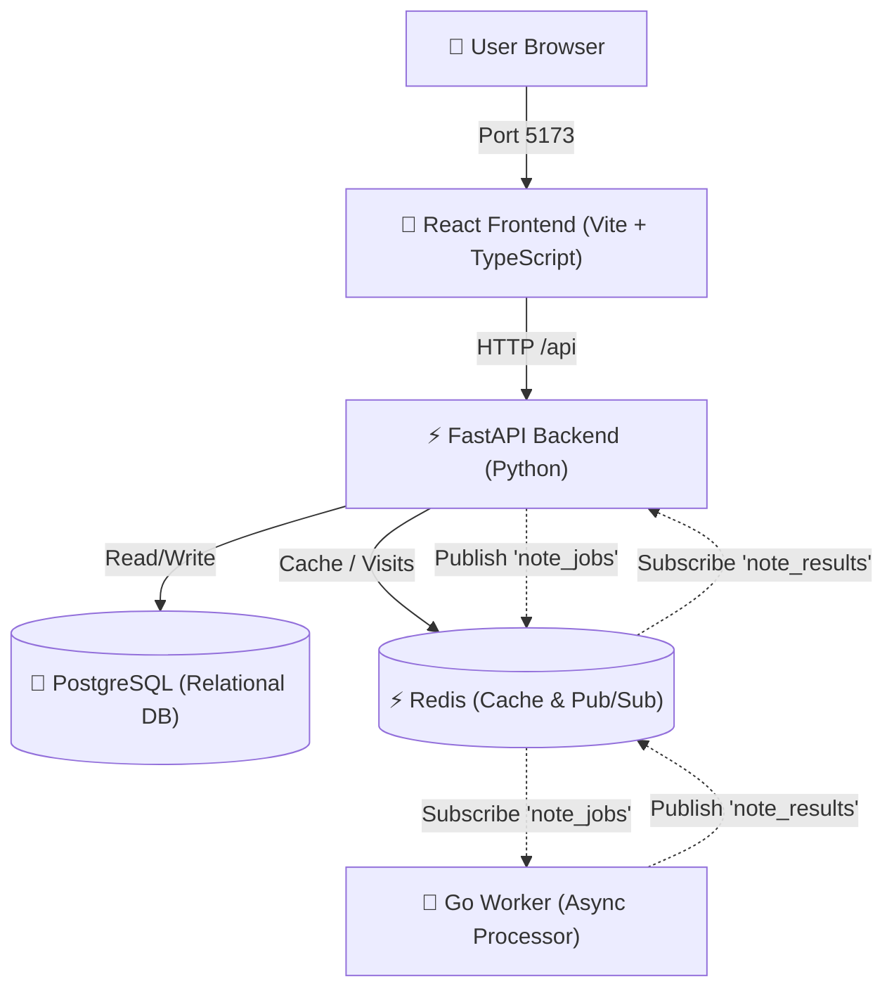

# 📝 5-Tier Distributed Notes Application

A modern, production-grade distributed notes application engineered across **5 distinct tiers**:
1. **React Frontend**: Single Page Application built with **React 18**, **TypeScript**, **Vite**, and **Tailwind CSS**.
2. **FastAPI Backend**: High-performance REST API built with **Python 3.11+**, **SQLAlchemy**, and **Pydantic v2**.
3. **Database Tier**: **PostgreSQL 16** for relational persistence with ACID transactions.
4. **Cache & Broker Tier**: **Redis 7** providing a 10-second TTL read cache for notes, atomic visit counting, and Pub/Sub message brokering.
5. **Background Worker Tier**: Concurrently compiled **Go (Golang)** microservice that subscribes to Redis Pub/Sub, computes note word counts, extracts summaries, and publishes results back to the database.

---

## 🏛️ Architecture Overview



### Event-Driven Async Job Flow:
1. User creates or edits a note in the React UI (`POST /api/notes`).
2. FastAPI saves the note in PostgreSQL with status `pending` and invalidates the Redis cache.
3. FastAPI publishes an event to Redis channel `note_jobs`.
4. The **Go Worker** receives the job, computes word count and summary, increments `worker:processed_count`, and emits the result to `note_results`.
5. The FastAPI background listener thread receives the message, saves `word_count` and `summary` to PostgreSQL, marks status `completed`, and clears the cache.
6. The Go worker writes a heartbeat (`worker:heartbeat`) every 5 seconds to Redis so the frontend HealthBar can monitor worker health in real time.

---

## 🚀 How to Run Locally (No Docker Required)

Follow these steps to run all 5 tiers natively on your local machine:

### 1. Prerequisites
Ensure you have the following installed on your machine:
- **Node.js** (v18+) & `npm`
- **Python** (v3.9+) & `pip`
- **Go** (v1.20+)
- **PostgreSQL** (v14+)
- **Redis** (v6+)

> On macOS with Homebrew, you can install services with:
> ```bash
> brew install postgresql@16 redis go node python
> brew services start postgresql@16
> brew services start redis
> ```

---

### 2. Database Setup (PostgreSQL)

Create the database and database user:
```bash
# Connect to your local postgres instance
psql postgres -c "CREATE USER notes_user WITH PASSWORD 'notes_password';"
psql postgres -c "CREATE DATABASE notes_db OWNER notes_user;"
psql postgres -c "GRANT ALL PRIVILEGES ON DATABASE notes_db TO notes_user;"
```

---

### 3. Start Redis

Ensure Redis is running on localhost port 6379:
```bash
redis-cli ping
# Should return: PONG
```

---

### 4. Start the Python FastAPI Backend

Open **Terminal 1**:
```bash
cd backend

# Create and activate virtual environment
python3 -m venv .venv
source .venv/bin/activate

# Install dependencies
pip install -r requirements.txt

# Start the FastAPI server (auto-creates database tables on startup)
uvicorn app.main:app --host 0.0.0.0 --port 8000 --reload
```
- Interactive Swagger API Documentation: [http://localhost:8000/docs](http://localhost:8000/docs)
- API Health Status: [http://localhost:8000/api/health](http://localhost:8000/api/health)

---

### 5. Start the Go Background Worker

Open **Terminal 2**:
```bash
cd worker

# Run the Go background worker
go run main.go
```
You will see output confirming connection and heartbeat:
```text
Config: REDIS_HOST=localhost, REDIS_PORT=6379
Connected to Redis at localhost:6379
Heartbeat goroutine started
Pub/sub subscriber started on channel 'note_jobs'
Listening for messages on channel 'note_jobs'
```

---

### 6. Start the React Frontend

Open **Terminal 3**:
```bash
cd frontend

# Install packages
npm install

# Start Vite development server
npm run dev
```
Open your browser to: **[http://localhost:5173](http://localhost:5173)**

The React UI will automatically connect to `http://localhost:8000` via the Vite reverse proxy configured in `vite.config.ts`.

---

## 🧪 Running Automated Tests

### Backend Unit Tests (Pytest + In-Memory SQLite)
```bash
cd backend
PYTHONPATH=. .venv/bin/pytest ../tests/test_backend.py -v
```

### Go Worker Unit Tests
```bash
cd worker
go test -v ./...
```

### Frontend Type-Checking & Production Build
```bash
cd frontend
npm run build
```

---

## 📡 API Endpoints Reference

| Method | Endpoint | Description |
|---|---|---|
| `GET` | `/` | API welcome message & docs link |
| `GET` | `/api/health` | Healthcheck verifying Postgres, Redis, and Go worker heartbeat |
| `GET` | `/api/visits` | Redis atomic visit counter (`INCR visits:counter`) |
| `GET` | `/api/notes` | List all notes with 10s Redis TTL cache and cache hit/miss status |
| `GET` | `/api/notes/{id}` | Retrieve single note with worker-computed word count and summary |
| `POST` | `/api/notes` | Create note, flush Redis cache, dispatch job to Go worker |
| `PUT` | `/api/notes/{id}` | Update note, reset worker status, dispatch job for reprocessing |
| `DELETE` | `/api/notes/{id}` | Delete note and invalidate cache |
| `GET` | `/api/worker/status`| Worker metrics: heartbeat, total processed jobs, queue depth |

---

## 🛠️ DevOps, Kubernetes & DevSecOps Learning Track

As requested, all Dockerfiles, Docker Compose, Kubernetes manifests, CI/CD pipelines, and DevSecOps security scanners have been structured as **hands-on, step-by-step beginner engineering issues** for you to write manually!

👉 **[Browse the 20 DevOps & DevSecOps Issues](./devops-issues/README.md)**:
- **Phase 1: Containerization (Docker)**: Backend, Go Worker, and React Dockerfiles + Docker Compose.
- **Phase 2: Kubernetes (K8s)**: Namespace, ConfigMaps, Secrets, Postgres StatefulSet/PVC, Redis, Backend, Worker, Frontend, and Ingress.
- **Phase 3: CI/CD Pipelines**: GitHub Actions for Automated Testing, Docker Image Build/Push to GHCR, and Kubernetes Validation & Deployment.
- **Phase 4: DevSecOps (Automated Security)**: Secret Scanning (Gitleaks), SAST (Bandit/Gosec/Semgrep), SCA Dependency Auditing (Trivy), Container Image CVE Scanning, K8s Pod Hardening & Zero-Trust NetworkPolicies, and DAST (OWASP ZAP).
